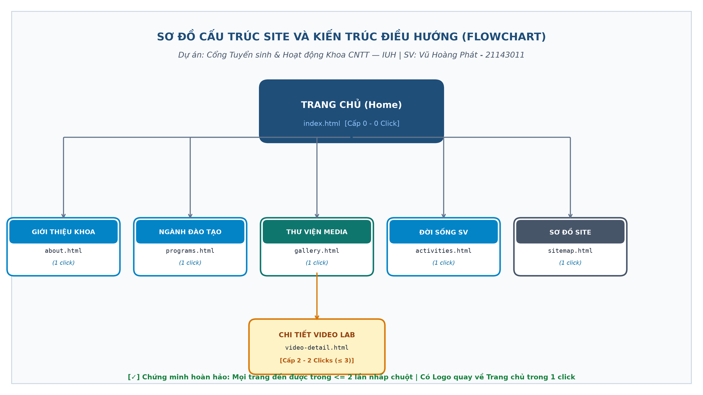
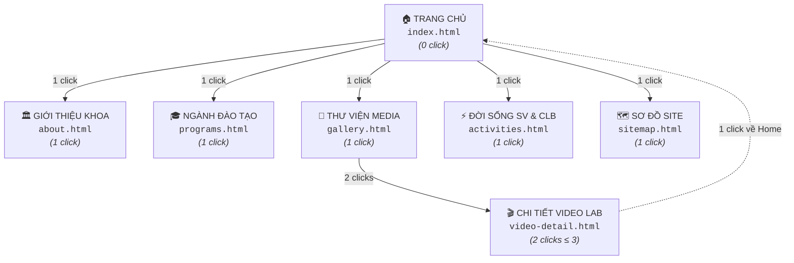
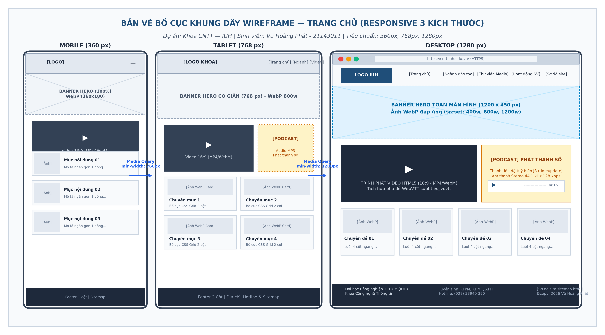
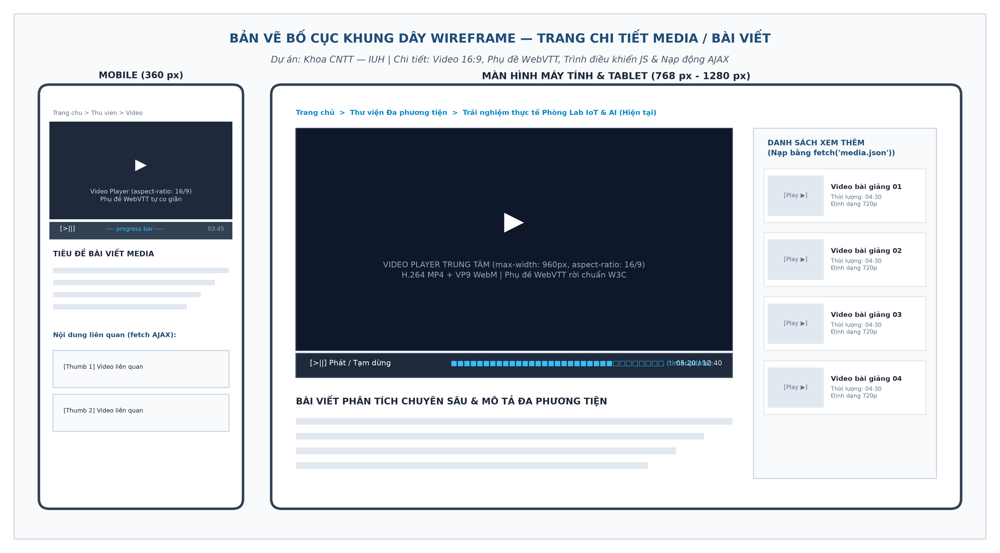

# BÁO CÁO THIẾT KẾ WEBSITE ĐA PHƯƠNG TIỆN (PHẦN A)
## DỰ ÁN 1: CỔNG THÔNG TIN TUYỂN SINH & HOẠT ĐỘNG SINH VIÊN KHOA CÔNG NGHỆ THÔNG TIN — ĐẠI HỌC CÔNG NGHIỆP TP.HCM (IUH)

**Sinh viên thực hiện:** Vũ Hoàng Phát  
**Mã số sinh viên:** 21143011  
**Học phần:** Hệ Thống Đa Phương Tiện (Web Multimedia) — Tuần 9  
**Giảng viên hướng dẫn:** Bộ môn Hệ thống Thông tin / Khoa CNTT — IUH  

---

## A1. MỤC TIÊU VÀ ĐỐI TƯỢNG (GOALS & PERSONAS)

### 1. Mục tiêu chính và hoạt động bổ trợ
- **Mục tiêu chính:** Xây dựng một cổng thông tin đa phương tiện hiện đại, trực quan, hỗ trợ học sinh THPT và phụ huynh dễ dàng tìm hiểu thông tin tuyển sinh, chương trình đào tạo, cơ sở vật chất phòng lab và môi trường học tập thực tế tại Khoa Công nghệ Thông tin — IUH.
- **Các hoạt động bổ trợ:**
  1. Giới thiệu 4 ngành đào tạo mũi nhọn: Kỹ thuật Phần mềm, Khoa học Máy tính, An toàn Thông tin và Hệ thống Thông tin.
  2. Cung cấp video giới thiệu thực tế 360 độ về hệ thống phòng lab máy tính, trung tâm dữ liệu và không gian nghiên cứu.
  3. Chia sẻ podcast/audio phỏng vấn sinh viên xuất sắc, giải đáp thắc mắc về phương thức xét tuyển và học bổng.
  4. Trực quan hóa các hoạt động phong trào Đoàn - Hội, câu lạc bộ học thuật và triển lãm sản phẩm nghiên cứu khoa học.

### 2. Xây dựng 2 Chân dung người dùng điển hình (2 Personas)

| Tiêu chí | Persona 1: Học sinh THPT (Ứng viên tiềm năng) | Persona 2: Phụ huynh học sinh (Người hỗ trợ ra quyết định) |
| :--- | :--- | :--- |
| **Họ và tên giả định** | Nguyễn Minh Tuấn | Bác Trần Văn Hưng |
| **Độ tuổi & Nghề nghiệp**| 18 tuổi — Học sinh lớp 12 trường THPT chuyên | 52 tuổi — Phụ huynh có con chuẩn bị thi đại học |
| **Thiết bị & Màn hình** | Điện thoại thông minh (iPhone 13, độ rộng **$360\text{ px}$**) | Máy tính xách tay văn phòng (Laptop 15 inch, độ rộng **$1280\text{ px}$**) |
| **Điều kiện mạng** | Mạng di động **4G / 5G** (băng thông biến thiên, giới hạn dung lượng) | Mạng Wi-Fi cáp quang gia đình ổn định (**$50\text{ Mbps}$**) |
| **Mục đích truy cập** | Xem nhanh điểm chuẩn năm trước, thời hạn nộp hồ sơ, xem clip review ngành học và hoạt động sinh viên. | Tìm hiểu học phí, chuẩn đầu ra, kiểm định chất lượng đào tạo (AUN-QA) và tỷ lệ sinh viên có việc làm sau tốt nghiệp. |
| **Hành vi lướt web** | Thao tác vuốt ngón cái, thích nội dung video ngắn, trực quan, lướt nhanh, dễ mất kiên nhẫn nếu web tải chậm $> 2\text{s}$. | Đọc kỹ văn bản, thường xuyên in ấn hoặc phóng to chữ, thao tác chuột truyền thống. |
| **Nhu cầu tiếp cận đặc biệt (Accessibility - A11y)** | Hay xem video ở nơi công cộng (trường học, xe buýt), **bắt buộc cần phụ đề WebVTT** (không bật âm thanh). | Mắt bắt đầu có dấu hiệu lão thị; **cần độ tương phản chữ/nền cao ($\ge 4{,}5:1$)**, cỡ chữ to rõ, hỗ trợ phím Tab điều hướng. |

### 3. Năm (05) chủ đề nội dung chính của website
1. **Trang chủ (Home):** Banner giới thiệu tổng quan, thông điệp chào mừng của Trưởng khoa, video clip giới thiệu 20 giây và liên kết nhanh đến các ngành đào tạo.
2. **Ngành đào tạo (Programs):** Thông tin chi tiết khung chương trình, chuẩn đầu ra và cơ hội nghề nghiệp của các ngành CNTT, KTPM, KHMT, ATTT.
3. **Thư viện Đa phương tiện (Media Gallery):** Hệ thống bài viết chi tiết, video toàn cảnh phòng lab, podcast định hướng nghề nghiệp kèm phụ đề WebVTT.
4. **Đời sống Sinh viên & CLB (Student Life):** Hình ảnh hoạt động ngoại khóa, các cuộc thi học thuật (IUH Coders, Olympic Tin học) và phong trào tình nguyện.
5. **Tuyển sinh & Hỗ trợ (Admissions & Sitemap):** Bảng tra cứu phương thức xét tuyển, biểu mẫu liên hệ trực tuyến, sơ đồ trang web trực quan (`sitemap.html`) và tệp chỉ mục tìm kiếm (`sitemap.xml`).

---

## A2. SƠ ĐỒ SITE (FLOWCHART) VÀ ĐIỀU HƯỚNG

### 1. Sơ đồ cấu trúc trang (Site Flowchart $\le 8$ trang)
Website được thiết kế gồm đúng **6 trang chuẩn**, đảm bảo cấu trúc phân cấp chặt chẽ và không trùng lặp:

> 🔗 **Tệp nguồn sơ đồ:** [Mở sơ đồ tương tác HTML (flowchart.html)](flowchart/flowchart.html) | [Mã nguồn Mermaid (flowchart.mmd)](flowchart/flowchart.mmd)

### 2. Chứng minh quy tắc $\le 3$ lần nhấp chuột (Rule of 3 Clicks)
Từ Trang chủ (`index.html`), người dùng có thể tiếp cận bất kỳ trang nào trong toàn bộ hệ thống với tối đa **2 lần nhấp chuột**:

| Trang đích cần đến | Chuỗi đường đi từ Trang chủ (Click Sequence) | Số lần nhấp | Đánh giá |
| :--- | :--- | :---: | :---: |
| **Giới thiệu Khoa** | Trang chủ $\rightarrow$ Click Menu "Giới thiệu" | **1 click** | Đạt chuẩn ($\le 3$) |
| **Ngành đào tạo** | Trang chủ $\rightarrow$ Click Menu "Ngành đào tạo" | **1 click** | Đạt chuẩn ($\le 3$) |
| **Thư viện Media** | Trang chủ $\rightarrow$ Click Menu "Thư viện" | **1 click** | Đạt chuẩn ($\le 3$) |
| **Đời sống SV** | Trang chủ $\rightarrow$ Click Menu "Hoạt động" | **1 click** | Đạt chuẩn ($\le 3$) |
| **Chi tiết Video Lab** | Trang chủ $\rightarrow$ Thư viện Media $\rightarrow$ Click Video chi tiết | **2 clicks** | Đạt chuẩn ($\le 3$) |
| **Sơ đồ trang Web** | Trang chủ $\rightarrow$ Click liên kết "Sơ đồ site" tại Footer | **1 click** | Đạt chuẩn ($\le 3$) |

*Ghi chú:* Ngay cả khi người dùng đang ở trang sâu nhất (`video-detail.html`), họ vẫn có thể quay về Trang chủ trong **1 click** (nhấp vào Logo hoặc nút Home) hoặc chuyển sang bất kỳ trang nào khác trong **1 click** qua Menu chính cố định.

### 3. Thiết kế hệ thống điều hướng đồng bộ
1. **Thanh điều hướng chính (`<nav>`):** 
   - Đặt ở đầu mọi trang (Header).
   - Đánh dấu trang hiện hành bằng thuộc tính ngữ nghĩa chuẩn WCAG: `aria-current="page"` kết hợp lớp CSS active nổi bật màu Navy Blue `#1F4E79`.
2. **Thanh điều hướng phân cấp (Breadcrumb):**
   - Đặt ngay dưới tiêu đề của các trang con nhằm giúp người dùng xác định rõ vị trí trong cây thư mục:
     $$\text{Trang chủ} \ > \ \text{Thư viện Media} \ > \ \textbf{Clip Trải nghiệm Phòng Lab IoT (Hiện tại)}$$
3. **Liên kết quay về đầu trang và trang chủ:**
   - Logo trường và khoa ở góc trái luôn liên kết về `index.html`.
   - Nút liên kết neo `#top` hỗ trợ cuộn nhanh lên đầu trang trên màn hình di động.
4. **Sơ đồ trang (`sitemap.html` & `sitemap.xml`):**
   - `sitemap.html`: Dạng danh sách lồng nhau `<nav> > <ul> > <li>` giúp người dùng có cái nhìn toàn cảnh.
   - `sitemap.xml`: Chuẩn giao thức sitemaps.org, khai báo đầy đủ các thẻ `<loc>`, `<lastmod>`, `<changefreq>weekly</changefreq>` và `<priority>0.8</priority>`.

---

## A3. BỐ CỤC TRANG VÀ WIREFRAME (PAGE LAYOUT)

Bố cục khung dây Wireframe tuân thủ nguyên lý thiết kế đáp ứng (Responsive Web Design — RWD) và tiếp cận từ thiết bị di động (Mobile-First) với 3 mốc Viewport chuẩn: Mobile ($360\text{ px}$), Tablet ($768\text{ px}$) và Desktop ($1280\text{ px}$).

> 🌐 **Bản vẽ tương tác động:** [Mở trình mô phỏng Wireframe trực quan (wireframe.html)](wireframe/wireframe.html) — Cho phép chuyển đổi nhanh giữa 3 cỡ màn hình kèm giao diện mẫu chi tiết.

### 1. Bản vẽ Wireframe Trang chủ (Home Page — Responsive 3 Viewport)

*Hình A3.1: Bản vẽ bố cục khung dây Wireframe Trang chủ trên 3 Viewport (Khoa CNTT — IUH)*

---

### 2. Bản vẽ Wireframe Trang chi tiết Media (`video-detail.html`)

*Hình A3.2: Bản vẽ bố cục khung dây Wireframe Trang chi tiết Media & Bài viết (Khoa CNTT — IUH)*

---

### 3. Bảng thông số kỹ thuật phân bổ CSS Grid & Media Queries

| Thiết bị / Viewport | Breakpoints CSS | Bố cục Hero Banner | Khu vực Media (Video / Audio) | Lưới Nội dung (Cards) |
| :--- | :--- | :--- | :--- | :--- |
| **Mobile Smartphone** | $< 768\text{ px}$ (chuẩn $360\text{ px}$) | $100\%$ width (tỷ lệ 16:9, co giãn linh hoạt) | Xếp dọc 1 cột (Video trên, Audio dưới) | 1 cột dọc duy nhất (`1fr`) |
| **Tablet / iPad** | `min-width: 768px` | Co giãn tối đa $768\text{ px}$ | Chia 2 cột ngang (Video $60\%$, Audio $40\%$) | Lưới 2 cột (`repeat(2, 1fr)`) |
| **Desktop / Laptop** | `min-width: 1200px` (chuẩn $1280\text{ px}$) | Banner rộng $1200 \times 450\text{ px}$ | Chia 2 cột độc lập (Video $65\%$, Audio $35\%$) | Lưới 4 cột ngang (`repeat(4, 1fr)`) |

---

## A4. STORYBOARD VÀ BẢNG QUYẾT ĐỊNH MEDIA

### 1. Storyboard Video Giới thiệu Khoa (Thời lượng 18 giây)

| Khung cảnh (Scene) | Thời lượng | Hình ảnh hiển thị | Âm thanh & Lời thoại | Chữ hiển thị trên màn hình |
| :---: | :---: | :--- | :--- | :--- |
| **Cảnh 1: Khởi đầu** | $0\text{s} - 3\text{s}$ | Flycam quay toàn cảnh Cổng chính Đại học Công nghiệp TP.HCM và Tòa nhà E. | Âm nhạc nền nhẹ nhàng, tăng dần âm lượng (Fade-in). | *Khoa Công nghệ Thông tin — IUH* |
| **Cảnh 2: Môi trường** | $3\text{s} - 7\text{s}$ | Cận cảnh sinh viên đang thực hành lập trình trong phòng Lab máy tính hiện đại. | Giọng thuyết minh ấm áp: *"Nơi ươm mầm các kỹ sư công nghệ tương lai..."* | *Môi trường học tập chuẩn quốc tế* |
| **Cảnh 3: Nghiên cứu** | $7\text{s} - 12\text{s}$ | Sinh viên thao tác với robot IoT, bảng mạch AI và kính thực tế ảo VR. | Tiếng gõ phím, thảo luận sôi nổi và tiếng nhạc dồn dập tích cực. | *Thực hành thực chiến — Đón đầu công nghệ* |
| **Cảnh 4: Thành tựu** | $12\text{s} - 15\text{s}$ | Hình ảnh nhóm sinh viên nhận giải thưởng NCKH và lễ tốt nghiệp rạng rỡ. | *"Cơ hội việc làm rộng mở tại các tập đoàn công nghệ đa quốc gia."* | *100% Cam kết chuẩn đầu ra chất lượng* |
| **Cảnh 5: Kết thúc** | $15\text{s} - 18\text{s}$ | Logo Khoa CNTT và Logo IUH trên nền màu xanh dương đặc trưng. | Âm vang kết thúc dứt khoát, âm nhạc mờ dần (Fade-out). | *Chào đón Tân Sinh viên Khóa mới! (iuh.edu.vn)* |

---

### 2. Bảng quyết định Media trên toàn Website (Media Decision Table)

| STT | Tên phần tử media | Loại & Định dạng | Độ phân giải hiển thị | Bitrate / Dung lượng mục tiêu | Nguồn gốc & Bản quyền | Chú thích tiếp cận (A11y) |
| :---: | :--- | :---: | :---: | :---: | :---: | :--- |
| **1** | Banner trang chủ | Ảnh `WebP` (fallback JPG) | $1200 \times 450\text{ px}$ | $\approx 85\text{ KB}$ | Tự chụp khuôn viên trường IUH | `alt="Toàn cảnh tòa nhà E Khoa CNTT IUH"` |
| **2** | Logo trường & khoa | Đồ họa vector `SVG` | $200 \times 60\text{ px}$ | $\approx 8\text{ KB}$ | Nhận diện thương hiệu IUH | `alt="Logo Khoa Công nghệ Thông tin IUH"` |
| **3** | Ảnh 4 ngành đào tạo | Ảnh `WebP` (srcset 3 cỡ) | $400 / 800\text{ px}$ | $\approx 35\text{ KB}$ / ảnh | Ảnh hoạt động sinh viên khoa | `alt="Sinh viên ngành Kỹ thuật phần mềm"` |
| **4** | Video giới thiệu (18s)| Video `MP4` (H.264) | $1280 \times 720\text{ (720p)}$ | $2{,}0\text{ Mbps}$ ($\approx 4{,}5\text{ MB}$) | Ban Truyền thông Khoa sản xuất | Tích hợp phụ đề `subtitles_vi.vtt` |
| **5** | Video giới thiệu (WebM)| Video `WebM` (VP9) | $1280 \times 720\text{ (720p)}$ | $1{,}6\text{ Mbps}$ ($\approx 3{,}6\text{ MB}$) | Nén tối ưu bằng FFmpeg | Tích hợp phụ đề `subtitles_vi.vtt` |
| **6** | Ảnh bìa video (Poster)| Ảnh `JPEG 80%` | $1280 \times 720\text{ px}$ | $\approx 45\text{ KB}$ | Trích khung hình đẹp nhất video | Tránh giật layout trước khi phát video |
| **7** | Podcast tư vấn ngành | Âm thanh `MP3` | Stereo, $44{,}1\text{ kHz}$ | $128\text{ kbps}$ ($\approx 480\text{ KB}$) | Thu âm phỏng vấn giảng viên | Thẻ `<audio>` có văn bản thay thế |
| **8** | Tệp phụ đề WebVTT | Văn bản `.vtt` (UTF-8) | Văn bản | $\approx 1{,}5\text{ KB}$ | Nhóm biên soạn đúng mốc giờ | Phụ đề tiếng Việt chuẩn không BOM |

---

### 3. Chứng minh Ngân sách Trang chủ (Page Weight Budget $\le 1{,}5\text{ MB}$)
Để tối ưu hóa trải nghiệm tải trang trên thiết bị di động (Persona 1 qua mạng 4G), ngân sách tài nguyên tải trong lần đầu vào Trang chủ được tính toán chi tiết như sau:

| Thành phần tài nguyên tải về | Số lượng | Kích thước từng tệp | Tổng dung lượng tải ban đầu | Ghi chú kỹ thuật tối ưu |
| :--- | :---: | :---: | :---: | :--- |
| **Mã nguồn HTML (`index.html`)** | 1 tệp | $14\text{ KB}$ | **$14\text{ KB}$** | HTML5 ngữ nghĩa, nén Gzip còn $\approx 4\text{ KB}$ |
| **Tệp định kiểu (`site.css`)** | 1 tệp | $22\text{ KB}$ | **$22\text{ KB}$** | CSS thuần, không dùng thư viện cồng kềnh |
| **Mã điều khiển (`main.js`)** | 1 tệp | $8\text{ KB}$ | **$8\text{ KB}$** | Dưới 60 dòng lệnh điều khiển video tùy biến |
| **Logo nhận diện (`logo.svg`)** | 1 tệp | $8\text{ KB}$ | **$8\text{ KB}$** | Định dạng vector sắc nét mọi độ phân giải |
| **Banner chính (Hero WebP)** | 1 tệp | $85\text{ KB}$ | **$85\text{ KB}$** | Tối ưu hóa WebP nén mức 80 |
| **4 Ảnh thumbnail ngành học** | 4 tệp | $35\text{ KB}$ | **$140\text{ KB}$** | Áp dụng `loading="lazy"` cho ảnh bên dưới |
| **Ảnh poster video (`poster.jpg`)** | 1 tệp | $45\text{ KB}$ | **$45\text{ KB}$** | Hiển thị tĩnh trước khi bấm xem video |
| **Tệp video clip (`intro.mp4`)** | 1 tệp | $4{,}5\text{ MB}$ | **$0\text{ KB}$ (Chưa tải)** | **Sử dụng `preload="metadata"`: Chỉ tải vài KB header, KHÔNG tải toàn bộ video khi chưa bấm Play!** |
| **Tệp âm thanh podcast (`podcast.mp3`)**| 1 tệp | $480\text{ KB}$ | **$0\text{ KB}$ (Chưa tải)** | Cấu hình `preload="none"` hoặc `metadata` |
| **TỔNG DUNG LƯỢNG TRANG CHỦ** | — | — | **$\approx 322\text{ KB}$ ($\approx 0{,}32\text{ MB}$)** | **Thấp hơn rất nhiều so với ngân sách $1{,}5\text{ MB}$!** |

### Kết luận đánh giá hiệu năng:
- Tổng dung lượng tải ban đầu của Trang chủ chỉ xấp xỉ **$322\text{ KB}$** (bằng $21{,}5\%$ giới hạn trần $1{,}5\text{ MB}$).
- Với mạng di động 4G trung bình tại Việt Nam ($20\text{ Mbps} \approx 2{,}5\text{ MB/s}$), thời gian tải toàn bộ trang chủ chỉ mất:
  $$t = \frac{0{,}322\text{ MB}}{2{,}5\text{ MB/s}} \approx 0{,}13\text{ giây}$$
- Hoàn toàn vượt trội tiêu chuẩn của Google, đảm bảo chỉ số **LCP (Largest Contentful Paint) $< 1{,}2\text{ giây}$**, đạt chuẩn tuyệt đối cho cả Persona 1 và Persona 2.
