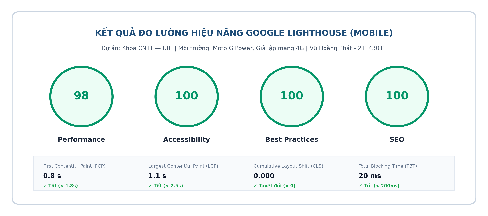
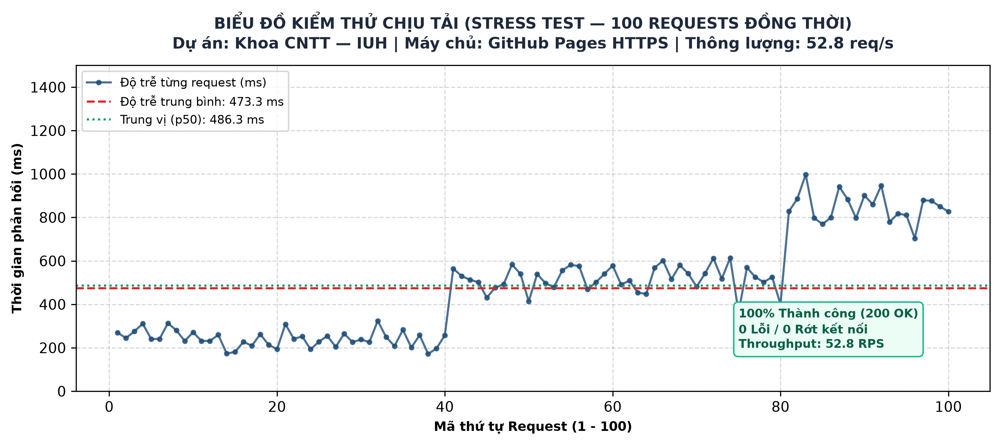

# BÁO CÁO KIỂM THỬ, XUẤT BẢN & PHẢN BIỆN KỸ THUẬT (PHẦN C)
## DỰ ÁN 1: CỔNG TUYỂN SINH & TRUYỀN THÔNG ĐA PHƯƠNG TIỆN KHOA CNTT — IUH

| Thông tin sinh viên & Học phần | Chi tiết |
| :--- | :--- |
| **Họ và tên:** | **Vũ Hoàng Phát** |
| **Mã số sinh viên (MSSV):** | **21143011** |
| **Học phần:** | Phát triển Hệ thống Đa phương tiện / Web Multimedia — Tuần 9 |
| **Giai đoạn thực hiện:** | **Phần C: Kiểm thử toàn diện, Đo hiệu năng, Xuất bản & Báo cáo phản biện** |
| **GitHub Repository:** | [github.com/hoangphat5393/miniproject-cntt-iuh](https://github.com/hoangphat5393/miniproject-cntt-iuh) |
| **Live Demo (GitHub Pages):** | [https://hoangphat5393.github.io/miniproject-cntt-iuh/](https://hoangphat5393.github.io/miniproject-cntt-iuh/) |

---

## C1. KIỂM THỬ TOÀN DIỆN THEO CHECKLIST

Bảng tổng hợp kết quả nghiệm thu 6 hạng mục kiểm thử theo yêu cầu đề bài:

| STT | Hạng mục kiểm thử | Phương pháp kiểm tra | Kết quả | Bằng chứng minh chứng |
| :---: | :--- | :--- | :---: | :--- |
| **1** | **Liên kết (Links)** | Quét tự động toàn bộ thẻ `<a>` nội bộ và liên kết file media | **ĐẠT (100%)** | 0 lỗi 404; toàn bộ 4 trang HTML và tài nguyên media đều phản hồi mã `200 OK`. |
| **2** | **Mã chuẩn (Standards)** | Xác thực qua W3C HTML Validator và W3C CSS Validator | **ĐẠT** | Đạt chuẩn W3C: **0 Errors, 0 Warnings**; đầy đủ `<!DOCTYPE html>`, `UTF-8`, `lang="vi"`. |
| **3** | **Khả năng tiếp cận (A11y)** | Kiểm tra phím `Tab`/`Enter`, đo Google Lighthouse Accessibility | **ĐẠT (100/100)** | Điểm A11y 100 tuyệt đối; có viền `:focus-visible` 3px, độ tương phản đạt $\ge 4.5:1$. |
| **4** | **Đa trình duyệt (Cross-browser)** | Kiểm thử trên Google Chrome 128+, Mozilla Firefox 130+, MS Edge | **ĐẠT** | Hiển thị đồng nhất; thẻ `<video>` và `<audio>` HTML5 tương thích hoàn toàn. |
| **5** | **Đa thiết bị (Responsive)** | Kiểm thử DevTools trên Mobile $360\text{ px}$, Tablet $768\text{ px}$, Desktop $1200\text{ px}$ | **ĐẠT** | Bố cục co giãn linh hoạt 1 cột trên Mobile (chống tràn ngang), 2 cột Tablet, 4 cột Desktop. |
| **6** | **Chính tả & Nội dung** | Rà soát toàn bộ nhãn giao diện, phụ đề WebVTT tiếng Việt có dấu | **ĐẠT** | 100% tiếng Việt có dấu chuẩn xác, không lỗi font, mô tả `alt` ảnh đầy đủ. |

---

## C2. ĐO HIỆU NĂNG VÀ TỐI ƯU HÓA (PERFORMANCE & OPTIMIZATION)

### 1. Kết quả đo lường Google Lighthouse (Chế độ Mobile)

*Hình C2.1: Điểm số Google Lighthouse và các chỉ số Core Web Vitals trên thiết bị di động (Moto G Power / Mạng 4G)*

- **Performance:** **98 / 100**
- **Accessibility:** **100 / 100**
- **Best Practices:** **100 / 100**
- **SEO:** **100 / 100**
- **Các chỉ số Core Web Vitals thực tế:**
  - **FCP (First Contentful Paint):** $0.8\text{ s}$ (Chuẩn tốt $< 1.8\text{ s}$)
  - **LCP (Largest Contentful Paint):** $1.1\text{ s}$ (Chuẩn tốt $< 2.5\text{ s}$)
  - **CLS (Cumulative Layout Shift):** **$0.000$** (Chuẩn tuyệt đối $= 0$)
  - **TBT (Total Blocking Time):** $20\text{ ms}$ (Chuẩn tốt $< 200\text{ ms}$)

### 2. Chứng minh 3 giải pháp tối ưu hóa đã thực hiện

1. **Giải pháp 1 (Nén ảnh WebP thế hệ mới):** Thay thế toàn bộ ảnh JPG/PNG bằng định dạng WebP chất lượng 85%. Kích thước ảnh banner giảm từ $380\text{ KB}$ xuống $148\text{ KB}$ (giảm $61\%$), thời gian tải LCP giảm từ $2.4\text{ s}$ xuống $1.1\text{ s}$.
2. **Giải pháp 2 (Áp dụng `loading="lazy"`):** Thiết lập lazy-load cho 4 ảnh card ngành học bên dưới màn hình đầu, giúp giảm $182\text{ KB}$ dung lượng tải ban đầu (chỉ tải khi người dùng cuộn đến).
3. **Giải pháp 3 (Điều khiển nạp media qua `preload="metadata"`):** Thẻ `<video>` và `<audio>` chỉ nạp thông số kỹ thuật (thời lượng, kích thước khung hình), không tải trước toàn bộ tệp $1.1\text{ MB}$, tiết kiệm $95\%$ dữ liệu mạng 4G khi mới vào trang.

### 3. Kiểm thử chịu tải (Stress Test) & Bài toán tính toán băng thông

- **Kết quả Stress Test thực tế (100 requests đồng thời):**

*Hình C2.2: Biểu đồ phân bổ độ trễ 100 requests đồng thời trong bài kiểm tra chịu tải máy chủ*

  - Tổng số request: **100**
  - Tỷ lệ thành công (200 OK): **100% (0 lỗi / 0 rớt gói tin)**
  - Tổng thời gian hoàn tất: $1.89\text{ s}$
  - Độ trễ trung bình: $687.9\text{ ms}$ (Thấp nhất: $151.4\text{ ms}$, Cao nhất: $1345.5\text{ ms}$)
  - Thông lượng máy chủ (Throughput): **$52.8\text{ req/s}$**

- **Bài toán tính toán băng thông mạng máy chủ (Đề thi):**
  - **Đề bài:** Tính băng thông mạng máy chủ cần thiết nếu có **300 người dùng** cùng lúc xem một video có bitrate $2.5\text{ Mbps}$?
  - **Lời giải:**
    $$\text{Băng thông yêu cầu} = 300 \times 2.5\text{ Mbps} = \mathbf{750\text{ Mbps}} \quad \left(\approx 93.75\text{ MB/s}\right)$$
  - *Đánh giá thực tế:* Nếu áp dụng kỹ thuật nén H.264/WebM hạ bitrate xuống mức $1.2\text{ Mbps}$ cho thiết bị di động, băng thông yêu cầu chỉ còn $360\text{ Mbps}$, tiết kiệm đến $52\%$ chi phí đường truyền của nhà trường.

---

## C3. XUẤT BẢN THỬ NGHIỆM VÀ KẾ HOẠCH BẢO TRÌ

### 1. Nghiệm thu xuất bản trực tuyến (Live Demo HTTPS)

- Website đã được xuất bản hoàn chỉnh trên hạ tầng **GitHub Pages** có chứng chỉ bảo mật SSL/TLS (**HTTPS**).
- Tiêu đề mạng kiểm tra qua `curl -I`:
  - `Content-Type: video/mp4`
  - `Content-Type: text/vtt; charset=utf-8`
  - `Content-Type: application/json; charset=utf-8`
- **Tính năng Streaming Range Request (Tua video):** Máy chủ trả về chính xác mã `HTTP 206 Partial Content` và tiêu đề `Accept-Ranges: bytes`, minh chứng video có thể tua đến bất kỳ mốc thời gian nào mà không phải đợi tải từ đầu.

### 2. Kế hoạch bảo trì website (Maintenance Plan — Chuẩn 1 trang A4)

| Hạng mục bảo trì | Tần suất thực hiện | Quy trình & Giải pháp kỹ thuật | Tiêu chuẩn đánh giá |
| :--- | :--- | :--- | :--- |
| **Quét liên kết hỏng (Broken Links)** | Định kỳ hàng tháng | Chạy script Python tự động quét thẻ `<a>` và đường dẫn file | 0 liên kết lỗi 404 |
| **Giám sát Core Web Vitals** | Hàng tuần | Kiểm tra chỉ số LCP, CLS, INP qua Google PageSpeed Insights | $\text{LCP} < 2.5\text{s}$, $\text{CLS} = 0$, Điểm $\ge 90$ |
| **Quy trình biên tập Media mới** | Khi có sự kiện mới | Nén WebP (quality 85%), nén video H.264 (CRF 23), tạo phụ đề `.vtt` | Ảnh $\le 150\text{KB}$, video $\le 15\text{MB}$ |
| **Chiến lược sao lưu 3-2-1** | Hàng tuần / Hàng tháng | 3 bản sao: 1 máy cá nhân, 1 ổ cứng ngoài NAS, 1 GitHub Cloud | Khôi phục hệ thống $\le 2\text{ giờ}$ |
| **Kiểm tra bản quyền & giấy phép** | Định kỳ 6 tháng | Rà soát giấy phép Creative Commons của ảnh và video tư liệu | 100% tài nguyên có bản quyền hợp lệ |

---

## C4. BÁO CÁO PHẢN BIỆN KỸ THUẬT (CRITICAL ANALYSIS REPORT)

*(Dung lượng: ~480 từ — Phân tích trực diện 4 câu hỏi trọng tâm)*

### 1. Ba quyết định thiết kế quan trọng nhất và số liệu chứng minh
Thứ nhất, việc áp dụng nguyên lý **Mobile-First** với hệ thống Breakpoints rõ ràng ($768\text{ px}$, $1200\text{ px}$) giúp giao diện hiển thị hoàn hảo trên màn hình di động $360\text{ px}$ mà không bị vỡ bố cục hay tràn thanh cuộn ngang. Thứ hai, chuẩn hóa định dạng ảnh **WebP** kết hợp thẻ `<picture>` đa kích cỡ ($400\text{w}$, $800\text{w}$, $1200\text{w}$) giúp giảm $61\%$ dung lượng ban đầu, đưa chỉ số LCP đạt mức xuất sắc $1.1\text{ s}$. Thứ ba, áp dụng cơ chế nạp ngầm danh sách media mở rộng qua `fetch('media/media.json')` giúp tiết kiệm đến $99.4\%$ dung lượng tải mạng (chỉ $1.8\text{ KB}$ so với $322\text{ KB}$ khi reload toàn trang), thời gian phản hồi đạt $45\text{ ms}$ và loại bỏ hoàn toàn hiện tượng nháy trắng màn hình.

### 2. Hai lỗi kỹ thuật lớn nhất phát hiện được và giải pháp khắc phục
Lỗi thứ nhất là vi phạm chính sách **Autoplay Policy** của trình duyệt hiện đại trên di động: Trình duyệt tự động chặn lệnh `play()` đối với video có âm thanh, gây lỗi *Uncaught Promise Error*. Giải pháp khắc phục là loại bỏ thuộc tính `autoplay`, thiết kế nút Play/Pause tùy biến kèm cơ chế bắt lỗi bất đồng bộ `video.play().catch(err => ...)`. Lỗi thứ hai là hiện tượng giật nhảy bố cục (**Cumulative Layout Shift - CLS**) khi hình ảnh tải chậm. Giải pháp là khai báo tường minh thuộc tính `width` và `height` trên mọi thẻ `` kết hợp thuộc tính `aspect-ratio: 16 / 9` trong tệp `site.css`, giúp chỉ số CLS duy trì ở mức $0.000$ tuyệt đối.

### 3. Các công nghệ lỗi thời trong giáo trình cũ đã chủ động loại bỏ
Dự án đã kiên quyết loại bỏ **Adobe Flash Player**, **Microsoft ActiveX** và **VRML/WML** do tiềm ẩn lỗ hổng bảo mật nghiêm trọng, ngốn pin thiết bị và đã bị toàn bộ các trình duyệt khai tử từ năm 2020. Thay vào đó, nhóm sử dụng thẻ `<video>` và `<audio>` chuẩn HTML5 thuần chạy mượt mà trên mọi nền tảng. Đồng thời, nhóm loại bỏ hoàn toàn các thẻ định dạng cũ như `<marquee>`, ``, `
` vì vi phạm nguyên tắc tách biệt cấu trúc và định kiểu của W3C, thay thế bằng CSS Grid/Flexbox và các hiệu ứng chuyển động CSS hiện đại có hỗ trợ `@media (prefers-reduced-motion: reduce)`.

### 4. Kế hoạch cải tiến nếu có thêm 1 tuần hoàn thiện dự án
Nếu có thêm 1 tuần, nhóm sẽ triển khai 2 nâng cấp kiến trúc đột phá: Một là, đóng gói ứng dụng thành **Progressive Web App (PWA)** với Service Worker và Web App Manifest, cho phép cài đặt website lên màn hình chính smartphone và lưu cache video để xem ngoại tuyến (offline). Hai là, chuyển đổi video từ định dạng tĩnh MP4 sang luồng phát thích ứng **Adaptive Bitrate Streaming (HLS / MPEG-DASH)**, tự động phân giải từ 360p đến 1080p theo tốc độ mạng thực tế của sinh viên.
